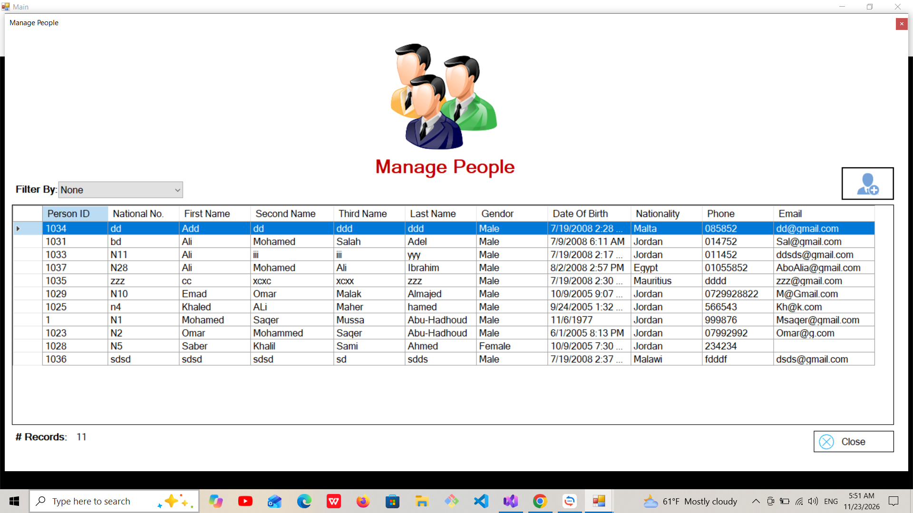
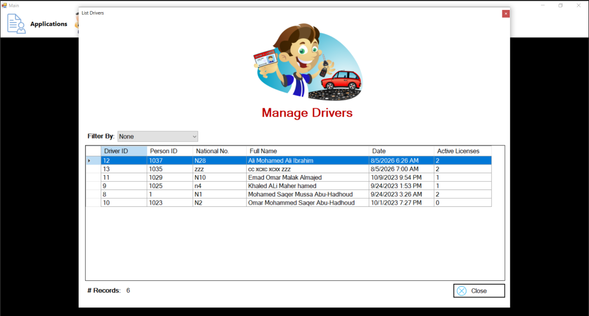
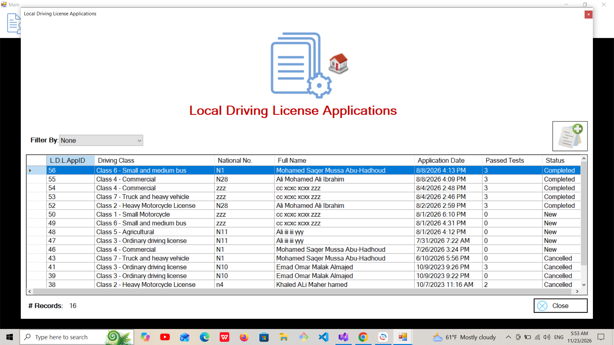
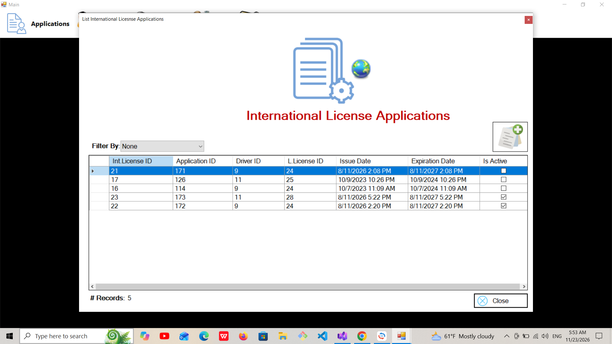

# DVLD - Driving & Vehicle License Department Management System

A desktop application designed to manage the operations of a Driving and Vehicle License Department.

The system helps organize people, drivers, applications, and driving licenses through a structured and maintainable application.

---

## 📌 Project Overview

The **DVLD Management System** is a Windows desktop application developed using C# and .NET Framework.

The project follows a **Three-Tier Architecture**, separating the application into three independent layers to improve code organization, maintainability, and scalability.

---

## 🏗️ Architecture

The application consists of three main layers:

### 1. Presentation Layer
- Provides the graphical user interface.
- Handles user interactions.
- Displays application data and results.

### 2. Business Logic Layer
- Contains the application's business rules.
- Handles business operations and validations.
- Connects the presentation layer with the data access layer.

### 3. Data Access Layer
- Handles communication with the SQL Server database.
- Executes database operations.
- Retrieves and updates application data.

---

## 🛠️ Technologies Used

- C#
- .NET Framework
- Windows Forms (WinForms)
- Microsoft SQL Server
- ADO.NET
- Visual Studio 2026

---

## ✨ Main Features

- People Management
- Drivers Management
- User Management
- Local Driving License Applications
- License Management
- International Driving Licenses
- Test Types Management

---

## 🖥️ Application Screenshots

### Main Dashboard


### People Management



### Users Management


### Drivers Management



### Local Driving License Applications



### International Driving Licenses



### Test Types Management


---

## 📂 Project Structure

```text
DVLD-Management-System/
│
├── DVLD/
│   ├── DVLD.sln
│   ├── App.config
│   └── ...
│
├── DVLD_Buisness/
│   └── ...
│
├── DVLD_DataAccess/
│   └── ...
│
├── Screenshots/
│   ├── Drivers.png
│   ├── International-Licenses.png
│   ├── Local-Licenses.png
│   ├── Main.png
│   ├── Manage Test Type.png
│   ├── People.png
│   └── Users.png
│
├── .gitignore
└── README.md
```

---

## ⚙️ Requirements

- Windows Operating System
- Visual Studio 2026
- The .NET Framework version targeted by the solution
- Microsoft SQL Server
- SQL Server Management Studio (SSMS)

---

## 🚀 Getting Started

### 1. Clone the Repository

```bash
git clone https://github.com/Omar-Ashraf-Hamza/DVLD-Management-System.git
```

### 2. Open the Project

Open `DVLD.sln` from the `DVLD` folder using Visual Studio.

### 3. Configure the Database

Make sure Microsoft SQL Server is installed and the required DVLD database is available.

### 4. Configure the Connection String

Open `App.config` in the startup project and update the connection string according to your SQL Server instance.

The application is configured to use Windows Authentication.

### 5. Build and Run

Build the solution and run the application from Visual Studio.

---

## 🗄️ Database Configuration

The application uses Microsoft SQL Server for data storage.

The database connection is configured through the application's configuration file (`App.config`).

Make sure the required database exists before running the application.

---

## 👨‍💻 Author

**Omar Ashraf Hamza**

- GitHub: [Omar-Ashraf-Hamza](https://github.com/Omar-Ashraf-Hamza)

---

⭐ If you find this project interesting, feel free to explore the repository!
