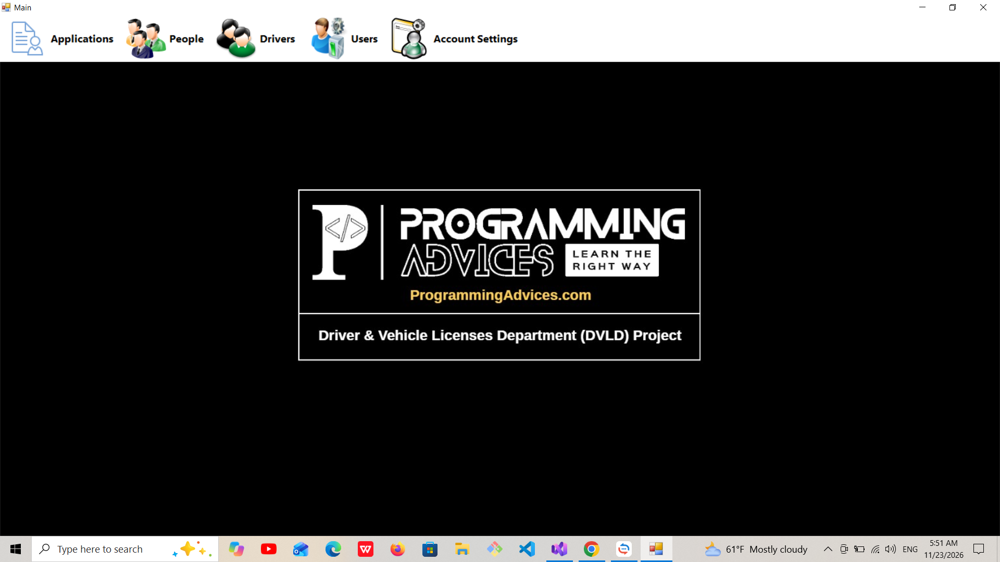
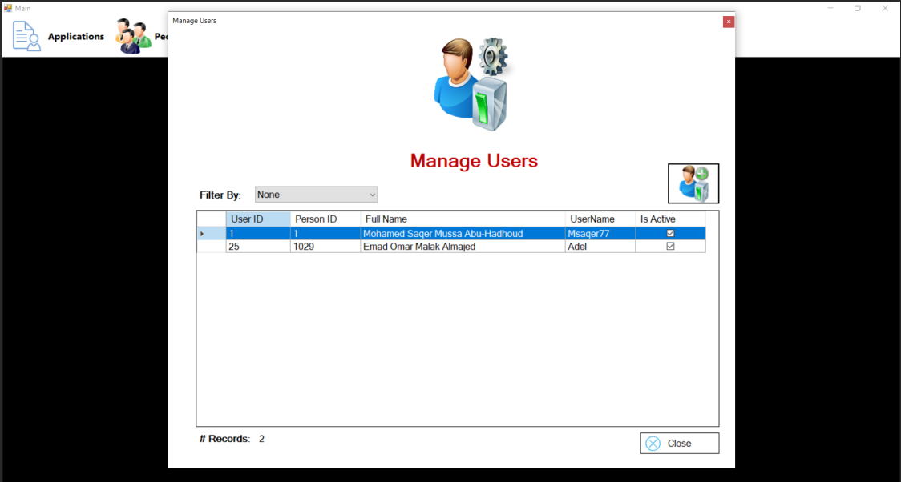

# DVLD - Driving & Vehicle License Department Management System

## 📌 Project Overview

DVLD is a Driving & Vehicle License Department Management System developed using C# and .NET Windows Forms.

The system helps manage people, users, drivers, driving license applications, local licenses, and international licenses through an organized desktop application.

## 🏗️ Architecture

The project follows the **Three-Tier Architecture**:

- **Presentation Layer:** Handles the user interface using Windows Forms.
- **Business Layer:** Contains business logic and application rules.
- **Data Access Layer:** Handles database operations and communication with SQL Server.

## 🛠️ Technologies Used

- C#
- .NET Windows Forms
- Microsoft SQL Server
- SQL Server Management Studio (SSMS)
- ADO.NET
- Visual Studio 2026
- Git & GitHub

## ✨ Main Features

- People Management
- User Management
- Driver Management
- Local Driving License Applications
- International Driving Licenses
- License Tests Management
- Application Types Management
- Database Integration

## 📸 Screenshots

### Main Dashboard


### People Management


### Users Management


### Drivers Management


### Local License Applications


### International Licenses


### Test Types Management


## 📂 Project Structure

```text
DVLD-Management-System/
│
├── DVLD/
│   ├── DVLD.sln
│   ├── App.config
│   └── Presentation Layer Files
│
├── DVLD_Buisness/
│   └── Business Layer Files
│
├── DVLD_DataAccess/
│   └── Data Access Layer Files
│
├── Screenshots/
│   ├── Drivers.png
│   ├── International-Licenses.png
│   ├── Local-Licenses.png
│   ├── Main.png
│   ├── Manage Test Type.png
│   ├── People.png
│   └── Users.png
│
├── DVLD_Database.sql
├── .gitignore
└── README.md
```

## ⚙️ Requirements

- Windows Operating System
- Visual Studio 2026
- The .NET Framework version targeted by the solution
- Microsoft SQL Server
- SQL Server Management Studio (SSMS)

## 🚀 Getting Started

### 1. Clone the Repository

```bash
git clone https://github.com/Omar-Ashraf-Hamza/DVLD-Management-System.git
```

### 2. Open the Project

- Navigate to the `DVLD` folder.
- Open `DVLD.sln` using Visual Studio.

### 3. Database Setup

To create the database, follow these steps:

1. Make sure Microsoft SQL Server is installed.
2. Open SQL Server Management Studio (SSMS).
3. Connect to your SQL Server instance using **Windows Authentication**.
4. Open the `DVLD_Database.sql` file included in this repository.
5. Execute the SQL script.
6. Make sure the `DVLD` database is successfully created.

### 4. Database Connection

The project uses **Windows Authentication** to connect to SQL Server.

The connection string is configured in `App.config`:

```xml
<connectionStrings>
    <add name="DVLD"
         connectionString="Server=.;Database=DVLD;Integrated Security=True;"
         providerName="System.Data.SqlClient" />
</connectionStrings>
```

**Note:** If your SQL Server instance name is different, update the `Server` value in the connection string.

### 5. Run the Application

- Build the solution.
- Run the application from Visual Studio.

## 👨‍💻 Author

**Omar Ashraf Hamza**

- GitHub: [Omar-Ashraf-Hamza](https://github.com/Omar-Ashraf-Hamza)

---

⭐ If you find this project useful, feel free to explore the repository!
